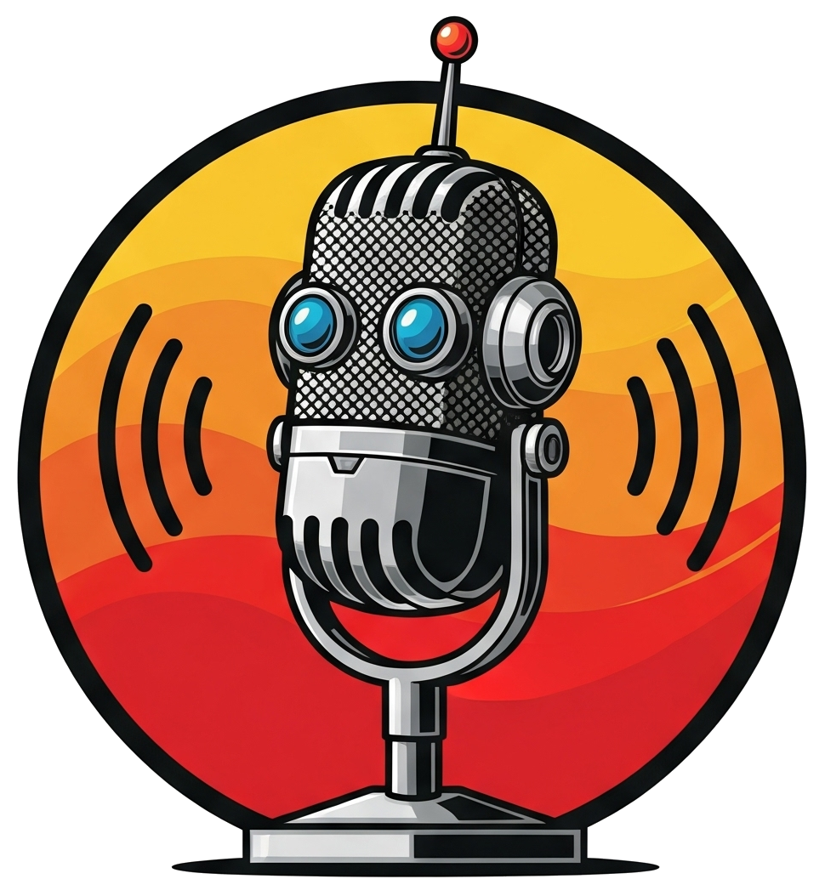
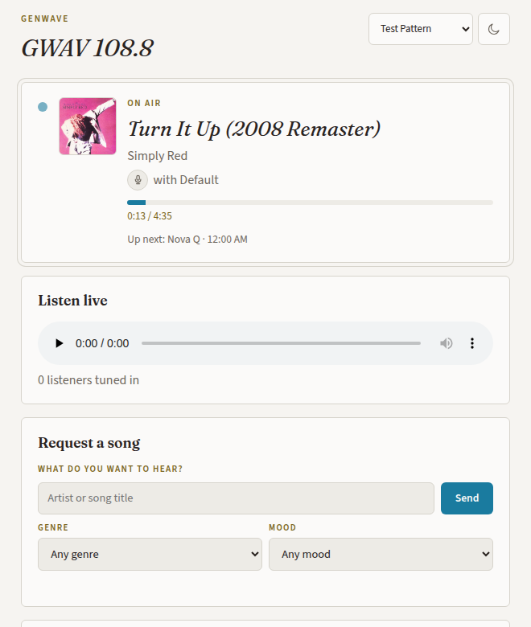
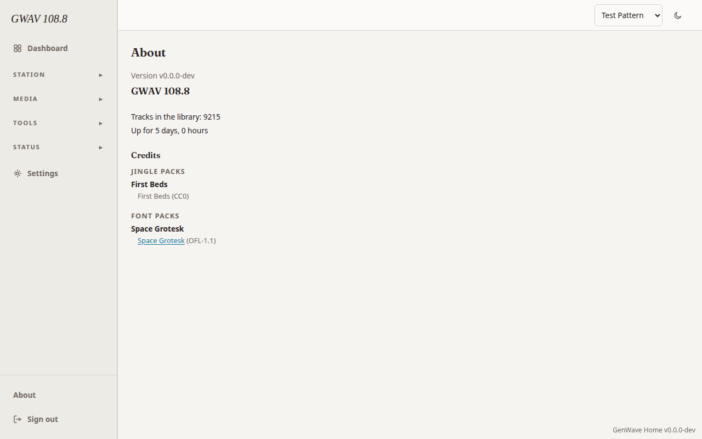

<p align="center"></p>

<p align="center"><b>A radio station for your house, with a DJ who knows the music.</b></p>

<p align="center">

[](https://github.com/GenWave-Org/genwave/actions/workflows/ci.yml)
[](https://github.com/GenWave-Org/genwave/releases)
[](LICENSE)
[](https://www.nuget.org/packages/GenWave.Abstractions)
[](https://github.com/GenWave-Org/genwave/actions/workflows/nightly.yml)

</p>

GenWave is my radio station. It plays my music library around the clock on the home network, with crossfades between tracks, every song at the same loudness, and a DJ who knows what is playing and tells you about it. It runs on Docker on one box in the house. It is open source, so you can run your own.

**Contents:** [Features](#-features) · [Getting started](#-getting-started) · [Why GenWave](#-why-genwave) · [Docs](#-docs) · [Built with](#-built-with) · [Contributing](#-contributing) · [License](#-license)

## ✨ Features



- 🎚️ Equal-power crossfades and loudness matching, so quiet and loud tracks play at the same volume.
- 🛟 The stream never stops. A safe rotation covers gaps, and the audio engine keeps playing even when the API or database is down.
- 🎙️ A DJ voice rendered on your own box (Kokoro, with Piper as the CPU-only fallback).
- 🧠 Optional local LLM (Ollama) writes what the DJ says between songs. Without one, the DJ uses templates.
- 🗓️ Named shows on a weekly schedule, so mornings and late nights sound different.
- 🎭 Personas: give the DJ a name, a voice and a style.
- 📣 Station sponsors and short ads, written and voiced on the box.
- 📻 A now-playing page for the house with song requests.
- 🛠️ An admin console for the library, schedule, voices and settings.
- 🧩 Plugins add new providers without forking the station.
- 🥧 Runs on amd64 and arm64. A 4 GB Raspberry Pi 5 is a known-good box.

<br clear="right">

<p align="center"></p>

## 🚀 Getting started

1. **Get the code.**
   ```bash
   git clone https://github.com/GenWave-Org/genwave.git && cd genwave
   ```
2. **Run the setup wizard.** It asks four questions, writes `.env` with fresh secrets, and starts the station.
   ```bash
   ./setup.sh
   ```
3. **Listen.** Open `http://localhost:8000/stream` in any audio player, and the admin console at `http://localhost:3000`.

Prefer a one-liner? [download.genwaveradio.com](https://download.genwaveradio.com/) fetches the same wizard.

You need Docker with Compose v2.24 or newer and a folder of `.mp3` or `.flac` files. [HARDWARE.md](HARDWARE.md) lists the boxes it runs on.

## 💡 Why GenWave

Twenty-plus years ago, in my first job as a software engineer, we pulled a lot of all-nighters, fueled by music that IT graciously let us keep on one of their servers (the Exchange server, if memory serves). We'd bring in CDs, IT would rip them, and when the last non-engineer left for the night, someone would fire up a playlist and start the stream.

It was great, until it wasn't. The problem with playlists is that they're dumb: same music, same order, every time. Being engineers, we solved it! Sort of. I wrote a playlist generator that jumbled the order on every run. Problem solved! Except now we were hearing B-sides and artists nobody recognized, with no good way to find out what was playing. It felt more like real radio, and it left us with a thought that stuck, with me at least: *wouldn't it be cool if we had DJs to announce the music?* There was no way to build that back then, so we coerced our QA lead into recording a few sound bites, played one every X tracks, and christened the result FLAP Radio (because reasons).

The itch never went away. Over the years I built a home version of FLAP Radio. Still, honestly, a playlist randomizer, and I was never truly happy with it. Then, a couple of years ago, LLMs and TTS started making a serious splash, and the itch came back in earnest: the technology had finally caught up with the idea. This time GenWave was born for real: a station that never stops broadcasting, knows what it's playing, and has a DJ who tells you about it.

Itch scratched. 📻

## 📚 Docs

| Doc | What is in it |
|---|---|
| [DEPLOYMENT.md](DEPLOYMENT.md) | Running it day to day: modes, services, settings, voices, troubleshooting |
| [HARDWARE.md](HARDWARE.md) | Boxes it runs on, sizing, which LLM fits your hardware |
| [PLUGINS.md](PLUGINS.md) | What a plugin is and how to write one |
| [CONTRIBUTING.md](CONTRIBUTING.md) | Building, testing, and the architecture rules |
| [SECURITY.md](SECURITY.md) | Reporting a security problem |

## 🧱 Built with

- **[Liquidsoap](https://www.liquidsoap.info/)** — the real-time mixing, crossfade, and encode engine underneath the whole broadcast.
- **[Icecast](https://icecast.org/)** — fans the mixed stream out to every listener.
- **[Kokoro](https://github.com/hexgrad/kokoro)** — the primary DJ voice, an open-weight TTS model rendered locally.
- **[Piper](https://github.com/rhasspy/piper)** — the CPU-only fallback voice that keeps a DJ talking on modest hardware.
- **[Ollama](https://ollama.com/)** — runs the local LLM that writes what the DJ says between songs when you point GenWave at one — the station airs template patter without it.
- **[ffmpeg](https://ffmpeg.org/)** — loudness, cue points, energy analysis: the numbers every crossfade decision rests on.
- **[aubio](https://aubio.org/)** — the BPM analysis behind every track's tempo.
- **[PostgreSQL](https://www.postgresql.org/)** — the catalog of record for every track, measurement, and scheduled show.

### 🤖 Built with AI assistance

GenWave is built with AI as a force multiplier, and every design decision, review and sign-off is mine; the `.claude/` toolkit in this repo is how it gets built, and you are welcome to use it. Hats off to Rob Conery for his [Claude Code Toolkit](https://ai.bigmachine.io/c/free-stuff/roll-your-own-claude-code-toolkit-bc0a72), and you can find the workflows I use [here](https://ai.bigmachine.io/c/hello).

## 🤝 Contributing

Bug fixes and small improvements are welcome. Read [CONTRIBUTING.md](CONTRIBUTING.md) first. It is short.

## 📄 License

GenWave is licensed under the [GNU Affero General Public License v3.0](LICENSE). The plugin contracts in [`src/GenWave.Abstractions/`](src/GenWave.Abstractions/) are MIT, so a plugin can link them under any license.
